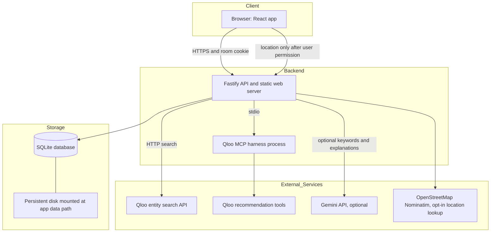
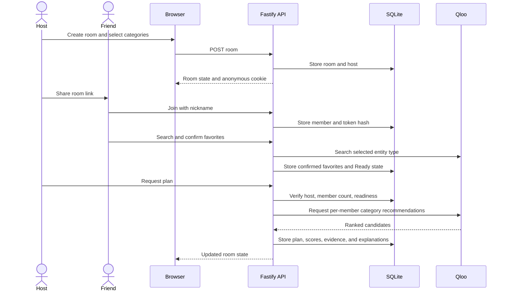
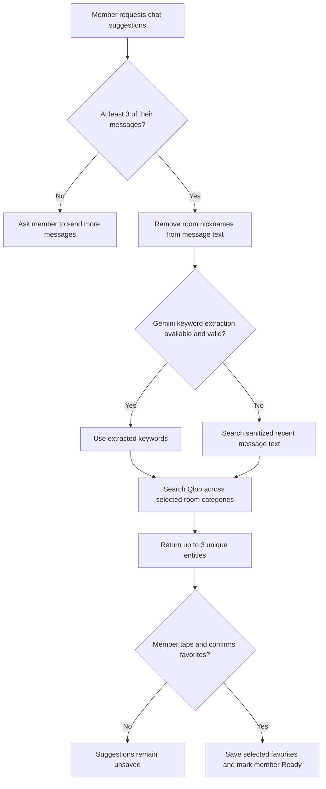
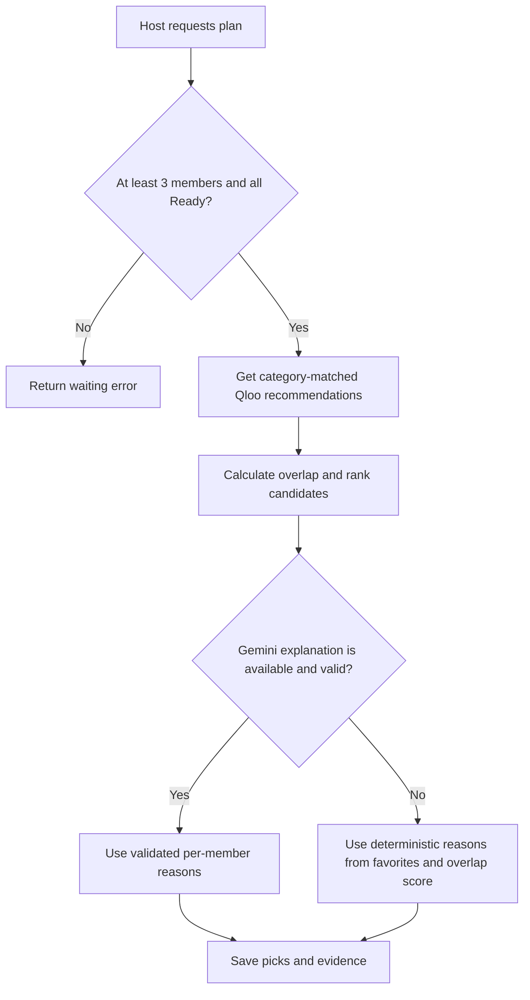
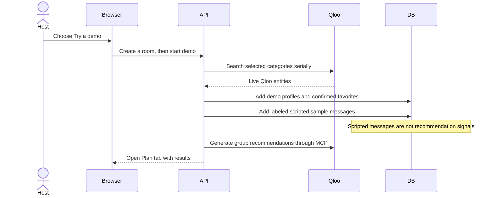

# Taste Bridge


> Hackathon / track: Qloo LLM Hackathon / Agent-powered app using Qloo cultural intelligence.
>
> Live demo: [taste-bridge.fly.dev](https://taste-bridge.fly.dev/)
>
> Repository: [Harshit-Awasthi-05/Taste-Bridge](https://github.com/Harshit-Awasthi-05/Taste-Bridge)

Taste Bridge turns the confirmed favorites of three to six friends into culturally grounded group plans. It uses Qloo's taste graph to recommend options per member and category, then ranks picks by group overlap so friends can see not only what the group might enjoy, but how each pick connects to their tastes. Members coordinate in private room chat, review Qloo evidence separately from optional AI explanations, and vote on picks.

## The Problem

Friends often spend more time agreeing on an activity than enjoying it. Each person has different tastes, and a group conversation does not always make those preferences easy to compare.

- Recommendations can feel generic or favor the loudest opinion.
- Relevant options vary across movies, music, TV, books, podcasts, and dining.
- Groups need a lightweight way to share preferences without creating accounts.
- It is useful to see why an option appeared, not just receive a list.

## Our Solution

1. **Collect:** A host creates a room, selects categories, and adds a city or area when dining is selected. Friends join with room-unique nicknames.
2. **Discuss:** Members coordinate through room-only text chat. A member can ask for Qloo suggestions based on their own recent messages.
3. **Select:** Each member chooses and confirms two to four Qloo search results. Suggestions are never saved automatically.
4. **Analyze:** Once at least three members are Ready, the host requests a plan. Qloo recommends candidates per category and member; chat-sourced confirmed favorites receive stronger ranking weight when combined with other favorites.
5. **Store:** Room data, favorites, messages, plans, votes, and related records are stored in SQLite and removed when the room expires.
6. **Present:** The Plan tab separates Qloo overlap and recommendation evidence from AI explanations, and lets members vote or ask the host to find new picks.

## Architecture Overview

In production, one Node.js process serves the built React app and Fastify API. The API authenticates room members with anonymous, room-scoped cookies, reads and writes SQLite, and connects to Qloo search and recommendation services. Gemini is optional and is used for chat keyword extraction and plan explanations. Browser location, when explicitly requested, is sent to OpenStreetMap Nominatim to resolve a city or area.



## Key Features

### Anonymous rooms

Create a room with one or more categories and share its URL. Friends join with a nickname unique within that room; accounts are not required. Before joining, the link shows only a coarse preview.

### Room chat

Joined members can exchange plain-text messages of up to 500 characters. Chat is the default room view, and messages are removed with the room. Demo rooms include a labeled scripted sample conversation; it does not drive demo favorites or recommendations.

### Qloo search and chat suggestions

Search Qloo manually for selected categories or cuisine/style tags. **Suggest from chat** uses only the requesting member's recent messages, optionally extracts keywords with Gemini, and falls back to searching sanitized message text when Gemini is unavailable. It returns up to three entities and does not save them automatically.

### Confirmed favorites and readiness

Members select two to four results from their own recent Qloo searches and explicitly confirm them. Chat alone does not make a member Ready. The roster distinguishes members who are chatting from members who have confirmed favorites.

### Group plan and evidence

The host can create a plan after at least three members have joined and everyone has confirmed favorites. Picks show Qloo's group overlap score and its evidence separately from per-member AI explanations or deterministic fallback text. Where available, cards list members surfaced by chat-derived signals before members surfaced by other favorites.

The overlap score is calculated as `100 × (0.5 × mean affinity + 0.5 × minimum affinity)`, rounded to an integer. When both signal groups exist for a member, chat-derived favorites receive 70% of the combined affinity and other favorites receive 30%. A signal group used by itself is not down-weighted.

### Demo friends

The host can start a solo demo that searches Qloo for two clearly labeled demo profiles, confirms live search results, and starts plan generation. A scripted sample conversation is for illustration only and is not used as recommendation input. Demo setup requires live Qloo search and an available Qloo MCP connection.

### Voting and regeneration

Room members can upvote or downvote active picks. Only the host can create or regenerate a plan. Picks already shown or rejected are excluded from later generations.

### Limits

| Limit | Behavior |
| --- | --- |
| Room size | 3 to 6 members for a generated plan |
| Confirmed favorites | 2 to 4 per member |
| Chat message | Up to 500 characters |
| Chat suggestions | At least 3 messages from the requesting member; reads up to the latest 5 and returns at most 3 entities |
| Qloo searches | 20 search tasks per member per minute |
| API requests | 120 requests per client IP per minute; health checks are exempt |
| Plan regeneration | 30-second cooldown after a completed generation |
| Room lifetime | 72 hours by default; `ROOM_TTL_HOURS` accepts 24 to 168 |

Rate-limit windows are held in memory and reset when the server restarts.

## Tech Stack

| Component | Technology | Description |
| --- | --- | --- |
| Language | TypeScript | Shared types, API, and browser application |
| Runtime | Node.js 22.19 or later | Runs the server and build tooling |
| Backend | Fastify 5 | JSON API, security headers, cookies, and static web serving |
| Frontend | React 19 | Room, chat, favorites, and plan interface |
| Build tool | Vite 7 | Development server and production web build |
| Shared package | npm workspaces | Shared category and application types |
| Database | SQLite with `better-sqlite3` | Room-scoped persistence with WAL mode |
| Recommendations | Qloo API and Qloo MCP harness | Entity search and per-member recommendations |
| AI | Gemini 3.6 Flash, optional | Chat keyword extraction and plan explanations |
| Location lookup | OpenStreetMap Nominatim | Resolves opt-in browser coordinates to a coarse locality |
| Container | Docker | Multi-stage image for the compiled app and Qloo harness |
| Hosting configuration | Fly.io | Single-machine configuration with a persistent volume |

## Logic Flows

### Main room and planning flow



### Chat suggestion flow



### Plan generation and explanation fallback



### Solo demo flow



## Project Structure

```text
Taste-Bridge/
├── .github/
│   └── workflows/
│       └── fly-deploy.yml         # Fly.io deployment workflow
├── .dockerignore                 # Files excluded from Docker build context
├── .env.example                  # Placeholder environment variable template
├── .gitignore                    # Ignores credentials, databases, and build output
├── Dockerfile                    # Multi-stage production container
├── fly.toml                      # Fly.io app, health check, VM, and volume config
├── LICENSE                       # MIT License
├── package.json                  # Workspace scripts and root tooling
├── package-lock.json             # Reproducible npm dependency lockfile
├── tsconfig.json                 # Root TypeScript configuration
├── vitest.config.ts              # Test runner configuration
├── docs/
│   └── PRD.md                    # Product requirements and scoring description
├── fixtures/
│   └── qloo/                     # Captured Qloo search and tag responses for tests
├── scripts/
│   ├── demo-plan.mjs             # Earlier three-profile engine walkthrough
│   └── smoke-qloo.mjs            # Live Qloo MCP smoke check
├── shared/
│   ├── package.json              # Shared workspace package
│   └── src/index.ts              # Shared category types
├── server/
│   ├── schema.sql                # SQLite schema
│   ├── package.json              # API dependencies and commands
│   ├── src/
│   │   ├── app.ts                # Fastify routes and room workflows
│   │   ├── index.ts              # Server startup and Qloo MCP connection
│   │   ├── db.ts                 # SQLite initialization and expiry cleanup
│   │   ├── session.ts            # Anonymous room cookie sessions
│   │   ├── qloo.ts               # Qloo search and MCP client helpers
│   │   ├── plan-engine.ts        # Recommendation scoring and explanations
│   │   ├── activity.ts           # Plan activity records
│   │   ├── demo-members.mjs      # Profiles for the earlier offline walkthrough
│   │   ├── plan-engine.mjs       # Earlier three-profile demo engine
│   │   └── qloo-client.mjs       # MCP client for the demo engine
│   └── test/
│       ├── app.test.ts           # API and room-flow tests
│       ├── plan-engine.test.ts   # Scoring and explanation tests
│       └── qloo.test.ts          # Qloo fixture tests
└── web/
    ├── index.html                # Browser entry document
    ├── package.json              # Web workspace dependencies and commands
    ├── vite.config.ts            # Vite plugins and API proxy
    └── src/
        ├── App.tsx               # Main room, chat, favorite, and plan UI
        ├── main.tsx              # React application entry point
        └── styles.css             # Application styles
```

## Installation and Setup

### Prerequisites

- Node.js 22.19 or later and npm
- Qloo API access for live entity searches
- The Qloo harness CLI for recommendations and tag search
- Optional Gemini API key for generated explanations and keyword extraction

### Quick start

Clone the repository, install locked dependencies, copy the environment template, and configure the local `.env` file with your own credentials. Do not commit `.env`.

**Bash**

```bash
git clone https://github.com/Harshit-Awasthi-05/Taste-Bridge.git
cd Taste-Bridge
npm ci
cp .env.example .env
npm install --global @qloo/qloo-harness
qloo setup --qloo
qloo setup --status
npm run dev
```

**PowerShell**

```powershell
git clone https://github.com/Harshit-Awasthi-05/Taste-Bridge.git
Set-Location .\Taste-Bridge
npm ci
Copy-Item .env.example .env
npm install --global @qloo/qloo-harness
qloo setup --qloo
qloo setup --status
npm run dev
```

Edit `.env` locally to replace placeholders with valid keys and endpoints. The Qloo harness must be configured for recommendations. The development web app is at <http://localhost:5173>; its Vite server proxies `/api` requests to Fastify on port 4000.

### Production build

```bash
npm run build
npm start
```

PowerShell:

```powershell
npm run build
npm start
```

The production server serves both the built frontend and API on port 4000 by default. It binds to `0.0.0.0`; `PORT` and `HOST` can override the listener settings.

## Environment Variables

Only variables present in `.env.example` or read by the application are listed.

| Variable | Required | Purpose |
| --- | --- | --- |
| `QLOO_API_KEY` | Yes for live Qloo search and demo | Server-side key for Qloo HTTP entity search; configure Qloo MCP access for recommendations |
| `QLOO_BASE_URL` | No | Qloo entity search base URL; defaults to `https://hackathon.api.qloo.com` |
| `QLOO_TRUSTED_BASE_URL` | For Qloo harness setup | Trusted Qloo API URL used by harness configuration |
| `GEMINI_API_KEY` | No | Enables Gemini chat keyword extraction and plan explanations; deterministic fallback is used when unavailable or invalid |
| `PORT` | No | HTTP listener port; defaults to `4000` |
| `HOST` | No | HTTP bind address; defaults to `0.0.0.0` |
| `ROOM_TTL_HOURS` | No | Room lifetime in hours; defaults to `72` and accepts values from `24` to `168` |
| `DATABASE_PATH` | No | SQLite file path; defaults to `data/taste-bridge.db` from the repository root |

Use `.env` for local development and your hosting provider's secret manager in production. Never put API keys in frontend code, `fly.toml`, or committed files.

## Security and Privacy

- No user accounts are required. Each member receives a room-scoped, HttpOnly anonymous cookie; the database stores a hash of the session token.
- Cookies use `SameSite=Lax`; the `Secure` attribute is enabled when `NODE_ENV=production`. Serve production traffic over HTTPS.
- Nicknames are room-scoped and are not sent to Qloo or Gemini. Nicknames are removed from recent message text before chat keyword extraction.
- Recent chat text may be sent to Gemini for keyword extraction. If extraction is unavailable, sanitized message snippets are sent to Qloo search instead. Avoid posting personal information in room chat.
- Browser coordinates are requested only after the creator opts in. They are sent to OpenStreetMap Nominatim for a coarse city lookup and are not stored or sent to Qloo.
- SQLite stores room state, city/area when provided, member nicknames and token hashes, confirmed Qloo favorites, room chat, plan evidence, votes, and related metadata. Room-owned records are deleted when the room expires.
- The app has no account or email field and does not store device IDs. Nicknames and chat text are stored with the room; search input blocks apparent email addresses and phone numbers.
- Helmet security headers, origin checks, request limits, and Qloo search limits are enabled by the API.
- Rooms expire after 72 hours by default. `ROOM_TTL_HOURS` is configurable from 24 to 168 hours.

## Deployment

### Docker

Build the image and run one container with a persistent named volume mounted where SQLite is stored. Provide credentials through a local `.env` file or a hosting secret manager.

**Bash**

```bash
docker build -t taste-bridge .
docker run --name taste-bridge --env-file .env -p 4000:4000 -v taste-bridge-data:/app/data taste-bridge
```

**PowerShell**

```powershell
docker build -t taste-bridge .
docker run --name taste-bridge --env-file .env -p 4000:4000 -v taste-bridge-data:/app/data taste-bridge
```

Open <http://localhost:4000>. The image includes the Qloo harness CLI, but not credentials.

### Fly.io

The checked-in [fly.toml](./fly.toml) configures the app as `taste-bridge` in Singapore (`sin`), uses the root Dockerfile, mounts `taste_bridge_data` at `/app/data`, sets a `/api/health` check, and requests a shared CPU VM with 1 CPU and 1 GB memory.

Authenticate and create the app configuration if needed:

```bash
fly auth login
fly launch --no-deploy
```

Create a 1 GB volume in the same region if it does not already exist:

```bash
fly volumes create taste_bridge_data --size 1 --region sin --app taste-bridge
```

Set secrets without committing them. Replace placeholders locally with your own values; do not paste working credentials into source control.

```bash
fly secrets set QLOO_API_KEY="your-qloo-key" QLOO_BASE_URL="https://hackathon.api.qloo.com" QLOO_TRUSTED_BASE_URL="https://hackathon.api.qloo.com" --app taste-bridge
fly secrets set GEMINI_API_KEY="your-gemini-key" --app taste-bridge
```

Deploy with a single machine:

```bash
fly deploy --ha=false
fly status --app taste-bridge
fly logs --app taste-bridge
```

Check <https://taste-bridge.fly.dev/api/health> and then open <https://taste-bridge.fly.dev/>. Keep one machine and the persistent volume attached in `sin`; SQLite and the local Qloo MCP process are not configured for multi-instance deployment. Fly.io charges for its resources, including running machines and volumes. Check current provider pricing before deploying.

Render Free does not provide persistent disks for SQLite. A free Render instance can be used for a temporary demonstration, but its local database should not be treated as persistent.

## Testing and Verification

Run the automated tests, typechecks, and production build from the repository root:

```bash
npm test
npm run typecheck
npm run build
```

The same commands work in PowerShell:

```powershell
npm test
npm run typecheck
npm run build
```

The API health endpoint returns the API status and whether the Qloo MCP connection is available:

```bash
curl https://taste-bridge.fly.dev/api/health
```

PowerShell:

```powershell
Invoke-RestMethod https://taste-bridge.fly.dev/api/health
```

Optional live Qloo checks and the earlier engine walkthrough are available as:

```bash
npm run qloo:smoke
npm run demo:plan
```

The Qloo smoke script requires configured live access. It records a fixture only when a live request succeeds.

## Typical User Journey

### Host

1. Open the live demo or start the app locally. Select categories, enter a nickname, and provide a city or area if Dinner is selected.
2. Create a room and share its invite URL with friends.
3. Add two to four favorites and confirm them, or use **Try a demo** for live Qloo-seeded demo profiles.
4. Wait for at least two friends to join and for all members to confirm favorites.
5. Choose **Make our plan**. Review Qloo overlap, separate explanation and signal evidence, and votes.
6. After a plan is ready, use **Find new picks** to regenerate when desired. A 30-second cooldown applies after generation completes.

### Friend

1. Open the host's room link and join with a nickname that is not already in use in that room.
2. Chat with the group and search for entities in the room's selected categories.
3. Optionally send at least three messages and choose **Suggest from chat**. Suggestions are not saved until selected and confirmed.
4. Confirm two to four favorites to become Ready.
5. Open the Plan tab to review and vote on current picks. Only the host can generate or regenerate the plan.

### Judge using the demo

1. Open the live demo URL and choose categories, a nickname, and a city when Dinner is selected.
2. Select **Try a demo**. Two clearly named demo profiles receive favorites from live Qloo searches.
3. Review the labeled scripted conversation, then open the Plan tab. The scripted messages do not drive recommendations.
4. Inspect the Qloo score, recommendation evidence, explanations, and planning activity.

## Future Scope

- Add a persistent database option for platforms that cannot provide a mounted disk.
- Improve resilience and user feedback when Qloo search or recommendation services are rate-limited or unavailable.
- Add accessibility and cross-device usability testing for the room, chat, and plan views.
- Expand the automated UI tests to cover creating a room, confirming favorites, running a demo, and regenerating a plan.

## License

Taste Bridge is released under the [MIT License](./LICENSE).
